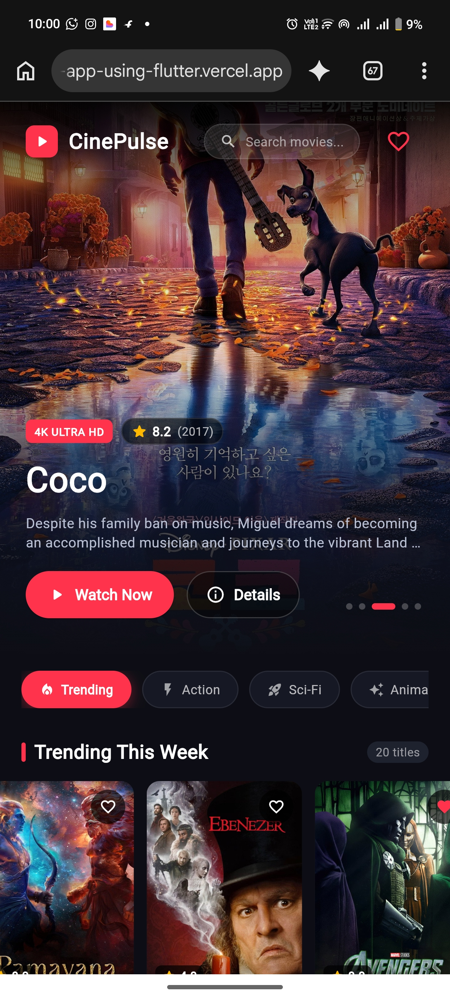
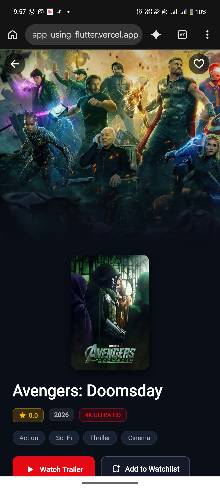
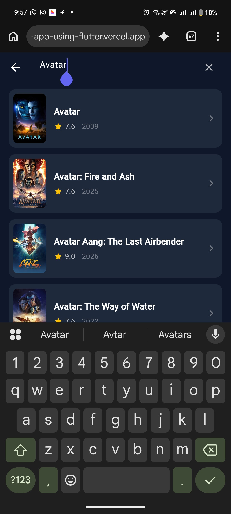
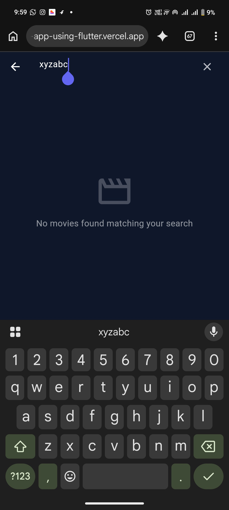
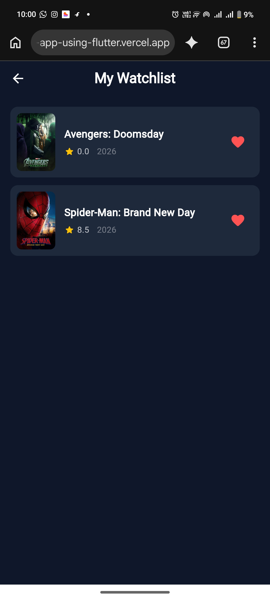

# 🎬 CinePulse - Flutter Movie Discovery App

A modern, responsive movie discovery application built with **Flutter & Dart**, integrated with the **TMDB (The Movie Database) API**. Designed with a dark cinema aesthetic, supporting live movie exploration, debounced search, detailed view with trailer preview, and persistent offline favorites.

Developed as part of **DevCamp 2.0 — Week 3 (Compulsory Project)**.

---

## ✨ Features Implemented

### 🌟 Required Core Features
- **Public API Integration**: Fetches real-time movie data via TMDB REST API.
- **Trending & Discovery**: Displays trending movies with 4K/HD posters, ratings, and release years.
- **Auto-Sliding Hero Carousel**: Featured titles rotating automatically with direct watch actions.
- **Search by Title**: Instant debounced search with live query handling.
- **Movie Details Screen**: Cinematic view with full-bleed backdrop, synopsis, genre chips, production stills, and trailer simulation.
- **Local Persistence (Watchlist)**: Add/remove favorites stored locally via `SharedPreferences` (survives app reloads).
- **Asynchronous UI States**: Loading shimmer/spinners, empty search states, and error handling with retry capability.

### 🚀 Optional Extensions Implemented
- **Interactive Genre Categorization**: Direct filters for Action, Sci-Fi, Animation, Drama, and Thriller.
- **Responsive Layout**: Fluid desktop and mobile adaptive layout.
- **Simulated Trailer Player**: In-app theatrical trailer modal dialog.

---

## 🛠️ Tech Stack & Packages

- **Framework**: Flutter (Channel stable)
- **Language**: Dart
- **State Management**: `provider: ^6.1.2`
- **Networking**: `http: ^1.2.1`
- **Local Storage**: `shared_preferences: ^2.2.2`
- **Image Handling**: `cached_network_image: ^3.3.1`

---

## 🔑 TMDB API Setup Instructions

For security reasons, private API credentials are not hardcoded in the public repository. Follow these steps to configure your own key:

1. Create a free account at [The Movie Database (TMDB)](https://www.themoviedb.org/).
2. Navigate to **Settings > API** and generate a free Developer (v3) API key.
3. Open `lib/services/api_service.dart` in your project.
4. Replace the placeholder with your actual key:
   ```dart
   static const String _apiKey = 'YOUR_TMDB_API_KEY_HERE';


🚀 How to Run the App


Clone the repository:


git clone https://github.com/Zishan-Saifi/cinepulse-movie-app.git
cd cinepulse-movie-app


Install Flutter dependencies:


flutter pub get


Run on Chrome (Web):


flutter run -d chrome


Run on Android / Emulator:


flutter run


📸 Screenshots


Home Page & Hero Carousel	Movie Detail Screen
(Add your screenshot here)	(Add your screenshot here)


Debounced Search	Watchlist / Favorites
(Add your screenshot here)	(Add your screenshot here)

## 📸 App Screenshots

| Home & Trending | Movie Details |
|:---:|:---:|
|  |  |

| Live Search | Empty State |
|:---:|:---:|
|  |  |

| Watchlist / Favorites |
|:---:|
|  |


🎥 Demo Video


Video Walkthrough: [▶ Click Here to Watch Demo Video](https://drive.google.com/drive/folders/1WM4NvMl-_XobXM-94yAE7ZKGZGZT6xJ8)


---